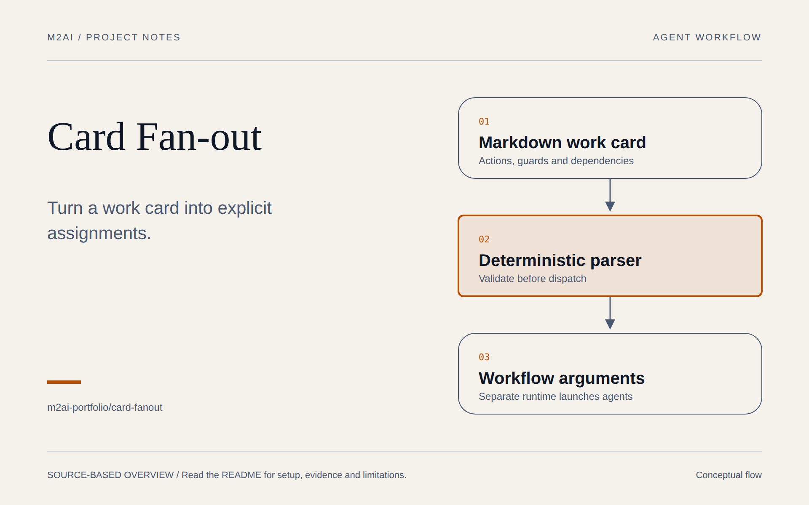

# card-fanout



You have already written the work: who needs it, where the result belongs, which steps matter, and what counts as done. Asking an agent to invent a second plan adds cost and creates room for drift. Card Fan-out carries the existing Markdown card into parallel agent work, with deterministic parsing before dispatch and explicit acceptance checks afterward.

This repository contains a Python parser and a separate script for Claude Code's Workflow tool. You can inspect the parser's output without launching agents or spending model tokens.

## Start with the included example

Requires Git and Python 3.9+ for the local parser. There are no Python package dependencies.

```bash
git clone https://github.com/m2ai-portfolio/card-fanout.git
cd card-fanout
python3 fan-out.py example/MY-CARD-0042.md --cards-dir example --mode recon --out args.json
```

Open `args.json` and compare its items and acceptance checks with [the example card](example/MY-CARD-0042.md). The example describes a deployment review, but this command only parses it. It does not build, push, deploy, or contact any service.

To run the agent half, you need a Claude Code environment that exposes the Workflow tool. Check your installed version and access before proceeding; this is not a standalone Node.js script. Use an authorized card with real targets and explicit boundaries, then follow the manual two-step below.

## What's in the box

**"card-fanout" is the name of the pipeline, not a command : there is no `card-fanout`
executable.** The repo ships two files that run separately, in two different runtimes,
in sequence:

| File | What it is | Who runs it | What it does |
|---|---|---|---|
| **`fan-out.py`** | a normal Python CLI | **you**, in a shell | reads a card file, validates its guards and dependencies, extracts the Action items, and prints an **args JSON**. Zero LLM calls : it never launches agents. |
| **`card-fanout.js`** | a Claude Code **Workflow script** : not executable on its own | **Claude Code's Workflow tool**, with the JSON from step 1 as `args` | the actual fan-out: one agent per item, in the mode the JSON specifies |

The output of the first is the input of the second. That's the whole contract.

There is no `--tags` or similar routing flag: the only switch is `--mode recon|execute`
on the Python side, which just gets embedded in the JSON.

## The easy path (inside Claude Code)

In practice you rarely run either half by hand. In a Claude Code session, say:

> Fan out card MY-CARD-0042 in recon mode using fan-out.py and card-fanout.js.

Claude runs the Python step, takes the JSON, and launches the Workflow for you. The manual
two-step below only matters when you want to inspect or edit the args between the halves :
or on the first run, so you see what each half actually produces.

## The manual two-step

```bash
# Step 1 (your shell): parse + validate the card, emit args
python3 fan-out.py MY-CARD-0042 --mode recon --out args.json
# refuses (exit 2) if owner/sink/kill are empty/none/tbd or a dependency isn't done

# Step 2 (inside Claude Code): launch the workflow with those args
#   Workflow({scriptPath: "card-fanout.js", args: <contents of args.json>})
# or simply tell Claude: "run card-fanout.js with the args in args.json"
```

## The idea

If you track work as one markdown card per task (YAML front-matter with `owner` / `sink` /
`kill` guards, an `## Action` list, a `## Done when` sentence), then **the card already IS
the plan**. You should not pay an LLM to re-plan it, and you should not let a re-plan drift
from the card's own rubric.

Why two files instead of one? Workflow scripts have no filesystem access, so the parsing
half *must* live outside. That constraint turns out to be the feature: validation is
deterministic and free, and the expensive part starts only after the card has earned it.

## Two modes

- **`recon`** (default): one **read-only** agent per Action item. Each returns structured
  findings, a pass/fail where verifiable read-only, and an exact live-probe plan for the
  mutating part. Run this before you decide anything.
- **`execute`**: cheap pinned workers (default `sonnet`) complete each item in parallel;
  the session model judges every result against its acceptance check and returns
  `{passed, failed: [{title, reason, fix}], artifacts}`. Run the session on your strongest
  model : it does the judging, the cheap model does the lifting.

No card? Pass `args: {request: "what to do", mode: "execute"}` and the session model plans
3-7 independent items first (the original plan/execute/verify shape this tool grew from).

## Card format

```markdown
---
id: MY-CARD-0042
title: One line
status: todo            # todo | doing | done | blocked
owner: who reads the result
sink: where the result lands
kill: when to stop trying
depends_on: []
---
## Action
1. First item ...
2. Second item ...
## Done when
One sentence an observer could verify.
```

The `owner`/`sink`/`kill` refusal implements the "no orphan loops" convention: work with no
reader, no destination, or no stop condition does not get to spend tokens.

Cards directory: `--cards-dir`, or `$CARDS_DIR`, or `~/vault/active-work/cards` by default.
An example card lives in [`example/`](example/).

## Why recon-first is the default

Recon asks workers to gather evidence and report the exact live probes that would be needed next. That makes it useful when several plausible explanations need to be checked before anyone changes a system. The mode is an instruction to the worker, not an operating-system sandbox; the calling session's permissions and review still matter.

## Boundaries and validation

- The parser supports the simple card format shown here, not arbitrary YAML syntax.
- Card guards are checked before emitting arguments. The parser also exposes a `--force` override, so those checks are not an unbypassable authorization layer.
- Agent execution depends on the host Workflow runtime and its permissions. A model's acceptance verdict should be checked against the actual artifact or system behavior.
- Use `--cards-dir` for your own card folder. The historical default points into the author's notes layout; that directory is not provided by this repository.
- For a local failure check, use a copy of the example with a missing `owner`, `sink`, or `kill`; the parser should refuse it with exit code 2. Restore the field and verify parsing succeeds. Agent execution needs a separate, bounded runtime test.

## Requirements

- Claude Code with the Workflow tool for the agent phase. The original project documented v2.1.154+; verify availability in your installation.
- Python 3.9+ (stdlib only)

## License

[MIT](LICENSE). Built by Matthew Snow / [M2AI](https://memyselfplusai.com). The workflow source credits the plan-fanout-verify pattern it adapts.
